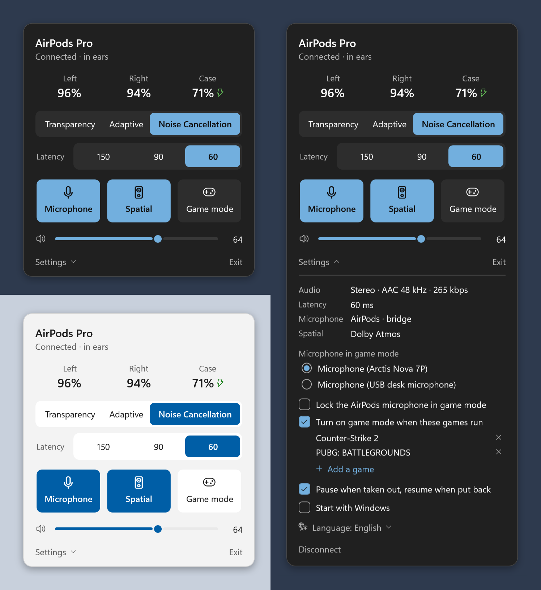

# PodPanel

A Windows tray panel for AirPods: battery, listening modes, latency, microphone, volume and automatic pause.



**Download:** get `PodPanel-Kurulum-<version>.exe` from the [latest release](https://github.com/fcs61/PodPanel/releases/latest).
The `.sha256.txt` file next to it lets you verify the download.

PodPanel is free and open source (GPL-3.0). It is an independent project: not made, endorsed or supported by Apple.
AirPods is a trademark of Apple Inc.

*Türkçe belge: [README.tr.md](README.tr.md)*

## What it does

- **Battery and state:** left, right and case battery, and whether the AirPods are in your ears.
- **Listening modes:** switch between Transparency, Adaptive and Noise Cancellation from the panel or the tray menu.
- **Latency:** lower the AirPods' audio buffer from 150 ms to 90 or 60 ms, so sound arrives sooner in games.
- **Microphone:** use the AirPods microphone while audio stays in stereo (Windows normally drops to mono call
  quality as soon as an app opens the microphone).
- **Auto-pause:** taking an earbud out pauses what is playing (Spotify, a browser video, anything that shows up in
  Windows' media controls); putting it back within 10 minutes resumes it. Games are not touched.
- **Volume bar:** shows and changes the AirPods' volume, in sync with the Windows volume bar, the keyboard keys and
  the AirPods' stem.
- **Game mode:** keeps the default microphone away from the AirPods so they stay in stereo; can turn on by itself
  when the games you choose are running.
- **Spatial sound:** one tile turns it on; it uses Dolby Atmos for Headphones if Dolby Access is installed, otherwise
  Windows Sonic.
- **13 languages:** English, Türkçe, Deutsch, Español, Français, Italiano, Nederlands, Polski, Português, Русский,
  日本語, 한국어, 简体中文. The panel follows your Windows display language; you can change it under Settings.

Battery, connection state, the volume bar, game mode and spatial sound work with the panel alone. Listening modes,
latency, the microphone and auto-pause need the **bridge service** described below.

## Before you install

Please read this section; PodPanel changes more on your computer than a typical tray app.

- **The installer is not code-signed.** Windows SmartScreen will warn you ("Windows protected your PC"); choose
  **More info → Run anyway**. Some antivirus programs may flag it as an unknown service installer.
- **It installs a driver and a service.** Windows does not let ordinary programs reach the AirPods' control channel.
  To get it, PodPanel installs [usbip-win2](https://github.com/vadimgrn/usbip-win2) (a third-party, signed USB/IP
  driver) and a Windows service that takes over your Bluetooth adapter and hands it back to Windows as a virtual
  adapter. Windows' own Bluetooth stack runs on top of it, so other Bluetooth devices are meant to keep working, but
  only AirPods have been tested.
- **A first install needs a restart**, and Bluetooth drops for a few seconds during install, update and uninstall.
- **Smart App Control blocks the bridge.** If it is on, Windows refuses to run the unsigned service. Setup detects
  this, does not touch the driver or Bluetooth, and installs the panel only.
- **It has been tested on one PC only:** Intel AX211 Bluetooth, Windows 11, AirPods Pro 3. Other USB Bluetooth
  adapters and AirPods models may or may not work; reports are very welcome.
- **Translations:** English and Turkish were written by hand. The other eleven languages are machine translations
  that no native speaker has reviewed yet.

## Requirements

- 64-bit Windows 11. Windows 10 version 2004 or later is accepted by setup but has not been tested.
- A Bluetooth adapter connected **over USB**. Most onboard Intel, Realtek and MediaTek adapters are.
- An administrator account.
- AirPods that are already paired with Windows.

Nothing else needs to be installed; the installer carries its own .NET runtime.

## Install

1. Run `PodPanel-Kurulum-<version>.exe` and confirm the SmartScreen and administrator prompts.
2. Setup checks the computer (Windows version, Bluetooth adapter, what is already installed) and shows what it will
   do. Leave **Create a restore point first** ticked. On a first install you can also choose whether the panel
   starts with Windows; this can be changed later in the panel's settings.
3. Click **Install**. The order is: restore point, panel, usbip-win2, bridge service. Your USB devices may disconnect
   for a moment while usbip-win2 installs; if Windows asks to confirm the driver, choose **Install**.
4. If usbip-win2 was installed for the first time, click **Restart**. After the restart the bridge service takes over
   the Bluetooth adapter and the panel starts by itself. Its icon sits in the notification area; if you cannot see
   it, look under hidden icons (`^`).

Setup is shown in English unless Windows is set to Turkish. Updating is the same file: setup offers **Update**
instead of Install.

## If something goes wrong

- **The bridge cannot take over Bluetooth:** after three failed attempts the service gives the adapter back to
  Windows' own driver. The panel shows a notice with a **Try again** button and keeps working without the bridge.
- **Logs:** `C:\ProgramData\PodPanel\kurulum.log` (setup; written in Turkish) and
  `C:\ProgramData\WPods\logs\service.log` (bridge service; English). Please attach both when you report a problem.
- **Bluetooth does not come back at all:** restart the computer. If that does not help, uninstall PodPanel; as a last
  resort use System Restore and go back to the point named "PodPanel kurulumu oncesi".

## Uninstall

Settings → Apps → Installed apps → **PodPanel** → Uninstall. The uninstaller removes the service, checks that
Bluetooth is back on Windows' own driver, and can remove usbip-win2 as well (tick the box). Your personal settings in
`%LOCALAPPDATA%\PodPanel` are kept.

## What setup changes on your computer

So that you can judge it for yourself:

- Files in `C:\Program Files\PodPanel` and a Start menu shortcut.
- The usbip-win2 driver, installed with its own installer (it appears as "USBip" in the Apps list). Setup verifies
  that installer's hash and signature before running it.
- A Windows service named `WPodsService`, running as Local System, which binds the Bluetooth adapter to WinUSB.
- usbip-win2's scheduled task "USBip Detach All On Reboot Or Shutdown" is disabled while the service is installed
  (it made Bluetooth drop after a shutdown with Fast Startup) and re-enabled on uninstall.
- A restore point named "PodPanel kurulumu oncesi", if you leave the box ticked.
- Optionally, a per-user startup entry for the panel.

The setup steps are plain PowerShell scripts you can read: [`kurulum/paket/kur.ps1`](kurulum/paket/kur.ps1) and
[`kaldir.ps1`](kurulum/paket/kaldir.ps1). They are also copied to `C:\Program Files\PodPanel\kurulum`.

## How it relates to WPods

The bridge service is a modified copy of the service from [WPods](https://github.com/FPNDev/WPods) (GPL-3.0), which
is a complete AirPods app for Windows in its own right; PodPanel would not exist without it. PodPanel uses that
service with its own tray panel and adds, among other things, game mode, auto-pause, the volume bar, an installer
with rollback, and fixes for Bluetooth dropping after shutdown and sleep. The changes to the service are listed in
[`bridge/CHANGES.md`](bridge/CHANGES.md) (in Turkish).

## Translations

Each language is one text file in [`src/Core/Diller`](src/Core/Diller) with `key = text` lines; English
(`en.txt`) is the reference. To fix a translation, edit the file and open a pull request. Missing keys fall back to
English.

## Building from source

You need the .NET 8 SDK for the panel and installer and the .NET 10 SDK for the bridge service.

```
powershell -NoProfile -ExecutionPolicy Bypass -File kurulum\paket\bagimliliklar.ps1
powershell -NoProfile -ExecutionPolicy Bypass -File kurulum\paket\servis-derle.ps1
powershell -NoProfile -ExecutionPolicy Bypass -File kurulum\paket\paketle.ps1 -Surum 1.0.0 -CalismaZamani 8.0.34
powershell -NoProfile -ExecutionPolicy Bypass -File kurulum\paket\paket-denetle.ps1 -Surum 1.0.0
```

The first script downloads and verifies the two external files (FFmpeg libraries, the usbip-win2 installer), the
second builds the bridge service, the third produces the installer in `%USERPROFILE%\PodPanel\dagitim`, and the last
one checks the package without installing anything. None of them needs administrator rights.

Releases are built the same way by GitHub Actions ([`.github/workflows/derle.yml`](.github/workflows/derle.yml)):
every push to `main` builds and checks the installer, and a version tag produces a draft release.

The code comments, script names and the detailed technical notes (how the latency setting, the microphone bridge and
the shutdown fixes work, the diagnostic tool, the repository layout) are in Turkish: see
[README.tr.md](README.tr.md).

## About the project

PodPanel is a personal project by one developer, written with heavy help from an AI coding assistant; the commit
history shows this openly. Bug reports are welcome in the [issue tracker](https://github.com/fcs61/PodPanel/issues),
especially from people with other Bluetooth adapters or AirPods models.

## License

PodPanel is distributed under the GNU General Public License version 3 (GPL-3.0); the full text is in
[LICENSE](LICENSE). The software is provided as is, without warranty.

The other components shipped in the installer (usbip-win2, FFmpeg libraries, the .NET runtime) and their licenses are
listed in [`kurulum/paket/UCUNCU-TARAFLAR.txt`](kurulum/paket/UCUNCU-TARAFLAR.txt) (in Turkish).

## Code signing policy

Free code signing provided by [SignPath.io](https://about.signpath.io), certificate by
[SignPath Foundation](https://signpath.org).

**Status:** an application to the SignPath Foundation programme has been made and is awaiting review. All releases so
far are **not signed**. This section will be updated when signing starts.

- Committers and reviewers: [fcs61](https://github.com/fcs61)
- Approvers: [fcs61](https://github.com/fcs61)

Since version 1.0.11 the installer is built from this repository by GitHub Actions
([`.github/workflows/derle.yml`](.github/workflows/derle.yml)); a version tag produces a draft release, which is
published by hand after the installer has been tested. Only binaries built this way from this repository's source are
to be signed. Third-party files shipped inside the installer (the usbip-win2 installer, FFmpeg libraries, the .NET
runtime) are unmodified upstream binaries and keep their own signatures.

### Privacy policy

This program will not transfer any information to other networked systems unless specifically requested by the user or
the person installing or operating it.

PodPanel has no update check, telemetry or account. It talks to the paired AirPods over Bluetooth and to the usbip-win2
driver over the local loopback address (127.0.0.1) only. Settings and logs stay on the computer
(`%LOCALAPPDATA%\PodPanel`, `C:\ProgramData\PodPanel`, `C:\ProgramData\WPods`). The bundled third-party components
(usbip-win2, FFmpeg libraries, .NET runtime) are used locally and are not known to send data either.
